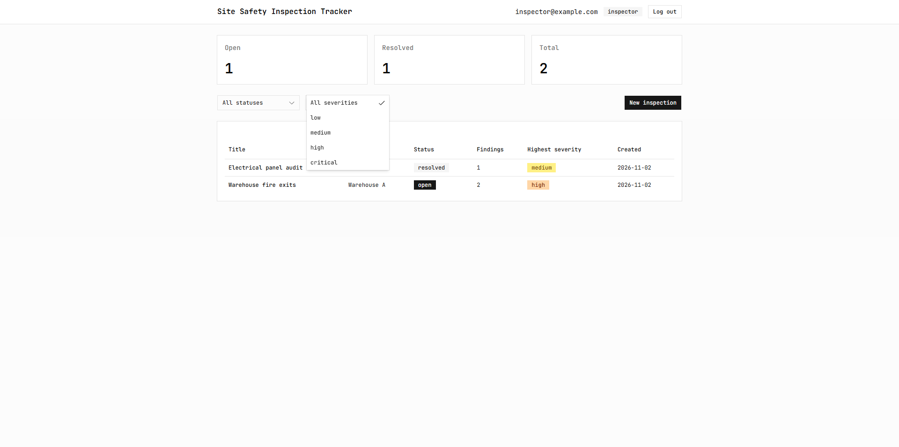
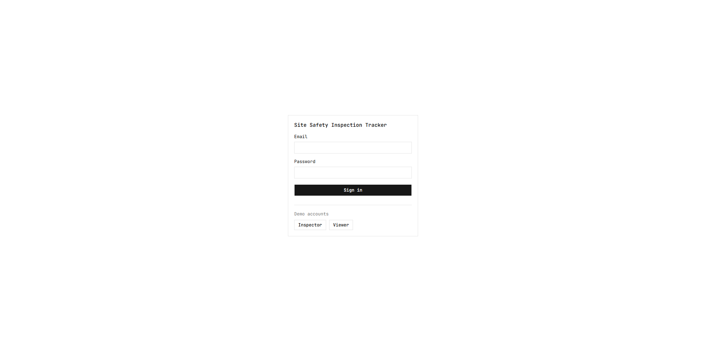
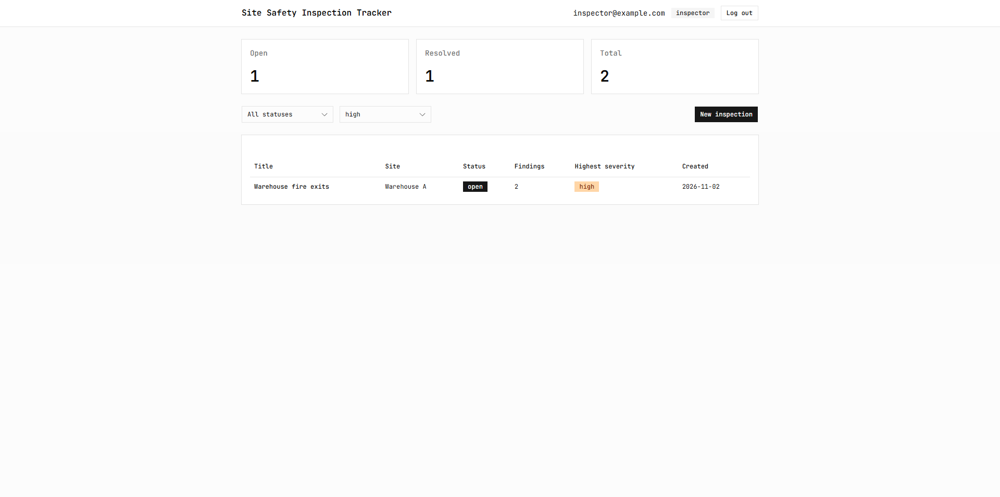
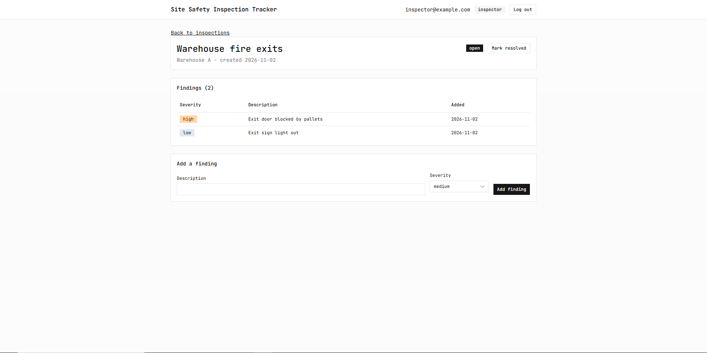
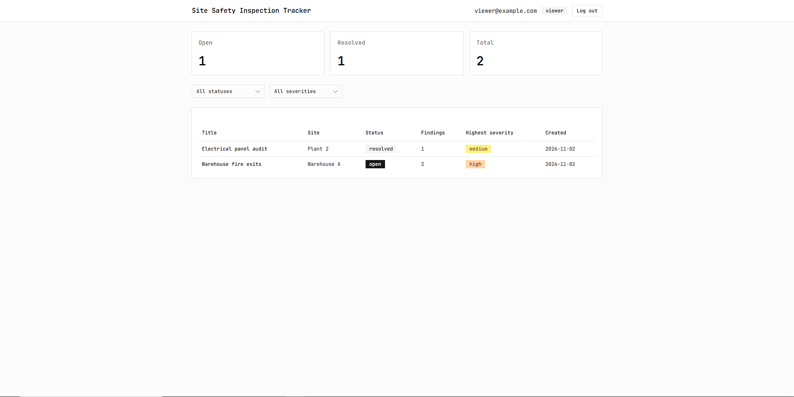
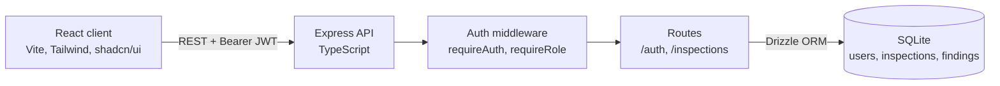

# Site Safety Inspection Tracker

A small full-stack app for recording site safety inspections and their findings, with role-based access. Built to show Node.js, Express, TypeScript, SQL, Tailwind CSS and shadcn/ui working together end to end, with tests and CI.

**Live demo:** https://inspection-tracker-1.onrender.com/

> The API runs on a free host that sleeps after 15 minutes idle, so the first load can take up to a minute. The database also resets whenever the host restarts, and the demo data is re-seeded each time.

| Role | Email | Password | Can do |
|---|---|---|---|
| Inspector | `inspector@example.com` | `inspector123` | Create inspections, add findings, mark open or resolved |
| Viewer | `viewer@example.com` | `viewer123` | Read only |

The login page has one-click buttons for both accounts.



| | |
|---|---|
|  |  |
|  |  |

## Features

- JWT login with two roles: **inspector** (create and edit) and **viewer** (read only)
- Inspections with findings, each finding has a severity (low, medium, high, critical)
- Dashboard with status and severity filters and open / resolved / total counts
- Role rules enforced on the server; the UI also hides write controls from viewers
- Input validation on every route

## Tech stack

| Layer | Technology |
|---|---|
| API | Node.js, Express, TypeScript (strict) |
| Database | SQLite via Drizzle ORM (better-sqlite3) |
| Auth | JWT (HS256), bcrypt password hashes |
| Validation | Zod |
| Front end | React (Vite), TypeScript, React Router |
| UI | Tailwind CSS v4, shadcn/ui |
| Tests | Vitest and Supertest |
| CI / delivery | GitHub Actions, Docker, Docker Compose |
| Hosting | Render (API as a Docker service, client as a static site) |

## Architecture



Every `/inspections` route requires a valid token. Write routes also require the inspector role, so a new route is protected by default. The app is built in `createApp(db)` and started separately in `index.ts`, so tests can drive it with Supertest without opening a port, using a fresh in-memory database per test.

## API

| Method and path | Who | Description |
|---|---|---|
| `POST /auth/login` | anyone | Returns a JWT (1 hour) and the user |
| `GET /auth/me` | signed in | Returns the user from the token |
| `GET /inspections?status=&severity=` | signed in | Lists inspections with findings, plus overall summary counts |
| `GET /inspections/:id` | signed in | One inspection with its findings |
| `POST /inspections` | inspector | Creates an inspection |
| `POST /inspections/:id/findings` | inspector | Adds a finding |
| `PATCH /inspections/:id` | inspector | Edits fields or sets open / resolved |

The severity filter returns inspections that have at least one finding of that severity.

## Run it locally

You need Node 22.

```bash
# API
cd server
npm ci
npm run seed      # creates the SQLite file with demo data
npm run dev       # http://localhost:3000

# Client (second terminal)
cd client
npm ci
npm run dev       # http://localhost:5173
```

Or with Docker:

```bash
cp .env.example .env   # set JWT_SECRET to a long random string
docker compose up --build
```

In production the API refuses to start without `JWT_SECRET`. The built-in development fallback only applies when `NODE_ENV` is `development` or `test`.

## Tests and CI

```bash
cd server
npm test
```

32 tests cover login and token handling (wrong password, expired, malformed and forged tokens), the role rules (a viewer gets 403 on every write route), filters, validation and the database constraints. GitHub Actions runs the typecheck, tests and build for the server, builds the Docker image and builds the client on every push.

## Decisions and trade-offs

- **SQLite over a hosted database:** zero setup and in-memory tests with no external service. The cost is a single instance, and on a free host the file is wiped on restart. Moving to Postgres would be the next step for real use.
- **Role stored in the JWT:** simple and stateless, but a role change only takes effect when the token expires (1 hour).
- **Same error for unknown email and wrong password,** with a dummy hash comparison, so login responses don't reveal which accounts exist.
- **Token kept in localStorage:** simple, but readable by any script on the page. HttpOnly cookies would be stronger.
- **Schema created with inline SQL** instead of generated migrations, to keep the scope small.

## Known issues

- `npm audit` reports findings in the `shadcn` command-line tool's dependencies (`deepmerge`, `ts-morph`). It is dev-time tooling and not part of the shipped bundle.
- `package.json` pins `better-sqlite3` to v12, because v13 builds from source on machines without a C++ toolchain.

## Project structure

```
server/   Express API, Drizzle schema, seed script, tests
client/   React app (pages, shadcn/ui components, API client)
docs/     Screenshots
```